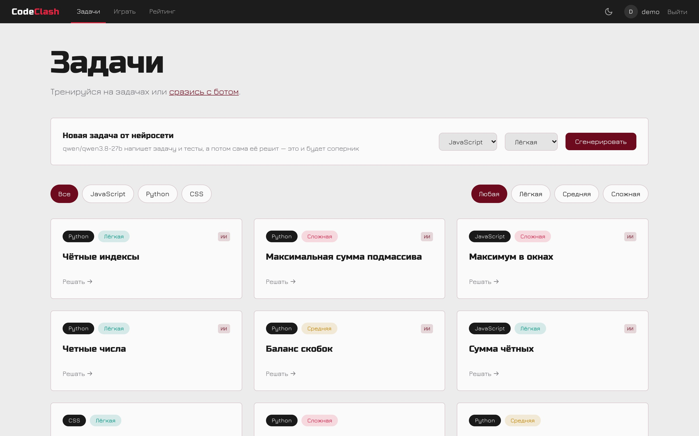
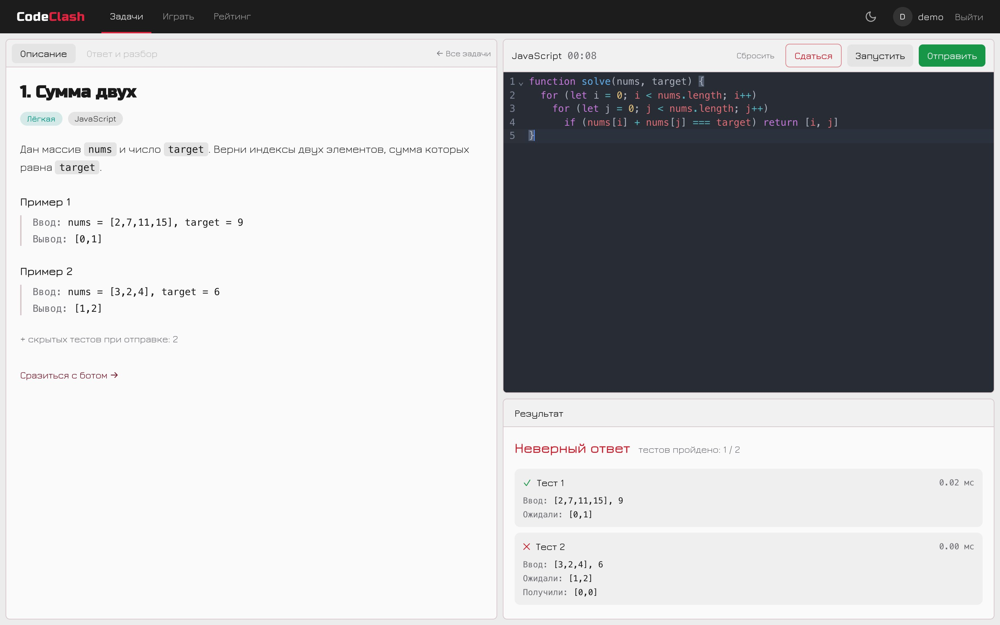
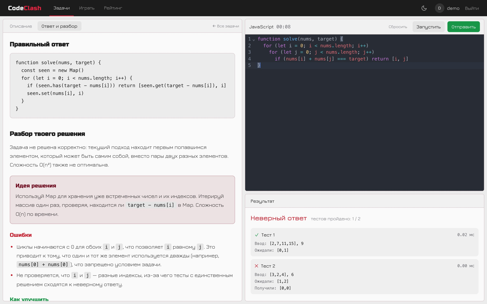
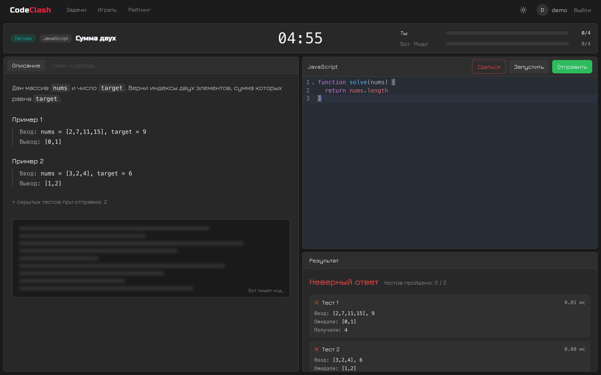
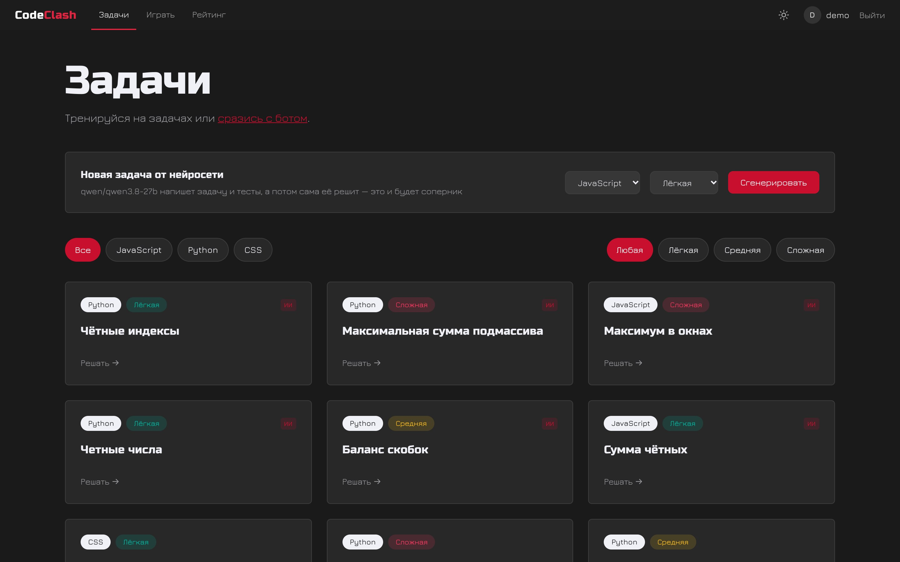
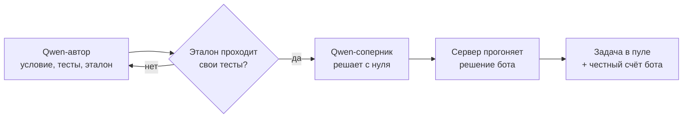
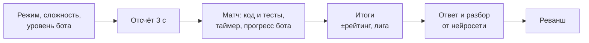

<div align="center">

# CodeClash

**Дуэли по программированию с нейросетью — на время.**

Нейросеть пишет задачу, решает её сама и становится твоим соперником.
Успей решить быстрее — а после матча получи правильный ответ и разбор своего кода.




[Возможности](#возможности) · [Как это работает](#как-это-работает) · [Быстрый старт](#быстрый-старт) · [Стек](#стек) · [Дорожная карта](#дорожная-карта)

</div>

---

## О проекте

CodeClash — веб-платформа, где разработчики соревнуются с нейросетью в скорости решения задач на **JavaScript** и **Python** (и в CSS-вёрстке — скоро).

Выбираешь режим, сложность и уровень бота → нейросеть уже решила задачу → у тебя 5, 8 или 12 минут, чтобы успеть раньше. Побеждает тот, кто первым пройдёт все тесты или наберёт больше к концу таймера. После матча меняются рейтинг и лига.

**Для кого:** студенты IT-специальностей, junior- и middle-разработчики, которые готовятся к собеседованиям и хотят тренировать скорость.

**Чем отличается:**

- **От LeetCode и Codewars** — таймер и соперник, а значит реальное давление, как на собеседовании.
- **От PvP-платформ** — соперник есть всегда, не нужно ждать живого игрока.
- **Задачи не заканчиваются** — их пишет нейросеть, а сервер проверяет, что они решаемы.
- **Разбор после каждой задачи** — нейросеть объясняет ошибки именно в твоём коде.

## Возможности



**Тренировка.** Условие слева, редактор CodeMirror справа, под ним результат: вердикт, каждый тест «ввод / ожидали / получили» и вывод `console.log` / `print`. «Запустить» — открытые тесты, «Отправить» — все, включая скрытые. ⌘ + Enter и ⌘ + Shift + Enter.



**Ответ и разбор.** Сдался или матч закончился — открывается эталонное решение и разбор твоего кода: решена ли задача, идея правильного решения со сложностью, конкретные ошибки и как улучшить. Нейросеть получает реальный результат автотестов, поэтому не назовёт рабочий код сломанным.



**Матч с ботом.** Обратный отсчёт, таймер по часам сервера, прогресс «Ты» и «Бот» в реальном времени, размытый «код бота». Три уровня соперника — Новичок, Мидл и Сеньор — отличаются скоростью и шансом застрять.



**И ещё:**

- Генерация новой задачи по кнопке — с тестами и проверенным эталоном.
- Аккаунты, рейтинг Эло по каждому языку, лиги от Bronze до Diamond, история матчей, таблица лидеров.
- Светлая и тёмная темы — переключатель в шапке, выбор запоминается.
- Честные итоги: исход матча считает только сервер, закрыть вкладку, чтобы не проиграть, не выйдет.

## Как это работает

### Нейросеть пишет и решает задачу



1. **Автор** придумывает задачу: условие, 2 открытых и 4 скрытых теста, эталонное решение.
2. **Сервер** прогоняет эталон по тестам. Не прошёл примеры из условия — задача в мусор. Не прошёл скрытый тест — нейросеть ошиблась в ответе, этот тест выкидывается.
3. **Соперник** решает задачу отдельно, видя только условие и примеры — как игрок.
4. **Сервер** прогоняет решение бота: сколько тестов оно честно прошло, столько бот и наберёт в матче. Решил не всё — бот может проиграть.

Всё это — **заранее**, по кнопке «Сгенерировать», а не во время матча: у бесплатных API маленькие лимиты.

### Как проходит матч



Бот «проигрывает» своё решение по расписанию: например, 2/4 теста на 90-й секунде, 4/4 — на 240-й. Расписание строится при старте и клиенту не отдаётся.

### Правила победы

1. Кто первым прошёл все тесты — побеждает сразу.
2. Время вышло — побеждает тот, у кого больше пройденных тестов.
3. Поровну — тот, кто раньше набрал свой результат.
4. Никто ничего не отправил — ничья.

## Быстрый старт

Нужны **Rust**, **Node.js 20+** и **Python 3** (на них запускается код игроков). Два терминала:

```bash
# Бэкенд → http://127.0.0.1:8000
cd backend
cp .env.example .env
cargo run
```

```bash
# Фронтенд → http://localhost:3000
cd frontend
npm install
npm run dev
```

Открой http://localhost:3000 → «Войти» → регистрация → «Играть».

**Нейросеть.** Без ключа всё работает на 7 стартовых задачах. Чтобы Qwen писала новые и делала разборы, создай бесплатный ключ на [console.groq.com](https://console.groq.com) и впиши его в `backend/.env`:

```
LLM_API_KEY=gsk_...
```

Подробнее и другие провайдеры (OpenRouter, локальная Ollama) — в [backend/README.md](backend/README.md#нейросеть-qwen).

## Стек

| Часть     | Технологии                                                         |
|-----------|--------------------------------------------------------------------|
| Backend   | Rust, actix-web, tokio, serde, sqlx (SQLite), argon2, JWT, reqwest |
| Frontend  | Nuxt 4, Vue 3, TypeScript, Tailwind CSS, CodeMirror 6              |
| Нейросеть | Qwen через OpenAI-совместимый API (Groq / OpenRouter / Ollama)     |
| Позже     | Docker-песочница для кода игроков, PostgreSQL для деплоя           |

## Структура

```
practica/
├── backend/            # API на Rust — открывается в RustRover как отдельный проект
│   ├── src/            # auth, tasks, runner, llm, matches, review, profile
│   ├── migrations/     # схема базы
│   └── requests.http   # готовые запросы ко всему API
├── frontend/           # клиент на Nuxt 4
│   └── app/            # страницы, компоненты, композаблы, дизайн-токены
└── docs/screenshots/   # картинки для этого README
```

Подробности — в README каждой части: [backend](backend/README.md) (API, правила матча, проверка решений) и [frontend](frontend/README.md) (страницы, дизайн-токены, устройство).

## Дорожная карта

Статусы: `✓` готово · `→` следующий шаг · `·` в планах

<details>
<summary><b>Backend</b> — 19 из 25 готово</summary>

| #   | Блок         | Задача                                                | Статус |
|-----|--------------|-------------------------------------------------------|--------|
| 1   | Основа       | Каркас сервера: `.env`, CORS, логи, `/api/health`     | ✓      |
| 2   | Основа       | Единый формат ошибок `{ "error": "..." }`             | ✓      |
| 3   | Задачи       | Модель задачи: режим, сложность, тесты, эталон        | ✓      |
| 4   | Задачи       | Стартовый набор задач вручную (3 JS, 3 Python, 1 CSS) | ✓      |
| 5   | Задачи       | `GET /api/tasks` — список с фильтром                  | ✓      |
| 6   | Задачи       | `GET /api/tasks/{id}` — задача без скрытых тестов     | ✓      |
| 7   | Проверка     | Обвязки JS и Python, сравнение ответов, вердикты      | ✓      |
| 8   | Проверка     | `POST run` / `POST submit`, вывод игрока              | ✓      |
| 9   | Проверка     | Автотесты `cargo test` и `requests.http`              | ✓      |
| 10  | Нейросеть    | Клиент Qwen (OpenAI-совместимый API, ключ в `.env`)   | ✓      |
| 11  | Нейросеть    | Промпт генерации задачи, ответ строго в JSON          | ✓      |
| 12  | Нейросеть    | Проверка задачи: эталон проходит все тесты            | ✓      |
| 13  | Нейросеть    | Нейросеть решает задачу за бота, решение проверяется  | ✓      |
| 13a | Нейросеть    | Разбор решения игрока: ошибки, идея, советы           | ✓      |
| 14  | Нейросеть    | Фоновое пополнение пула задач (сейчас — по кнопке)    | →      |
| 15  | Матч         | Профили бота и расписание его прогресса               | ✓      |
| 16  | Матч         | Таймер, правила победы, итоги                         | ✓      |
| 17  | Матч         | WebSocket вместо опроса раз в секунду                 | ·      |
| 18  | CSS          | Рендер вёрстки и попиксельное сравнение с макетом     | ·      |
| 19  | Безопасность | Docker-песочница для кода (после фронта, до деплоя)   | ·      |
| 20  | Данные       | База SQLite: задачи, аккаунты, матчи, рейтинг         | ✓      |
| 20a | Данные       | Переезд на PostgreSQL для деплоя                      | ·      |
| 21  | Данные       | Регистрация и вход (argon2 + JWT)                     | ✓      |
| 22  | Данные       | Рейтинг (Elo), лиги, история, таблица лидеров         | ✓      |
| 23  | Данные       | Админка: одобрение задач от нейросети                 | ·      |

</details>

<details>
<summary><b>Frontend</b> — 15 из 16 готово</summary>

| #   | Блок    | Задача                                             | Статус |
|-----|---------|----------------------------------------------------|--------|
| 1   | Основа  | Каркас Nuxt 4 + Tailwind, общий макет              | ✓      |
| 1a  | Основа  | Светлая и тёмная темы, шрифты, дизайн-токены       | ✓      |
| 2   | Основа  | Типы под ответы API и композабл `useApi`           | ✓      |
| 3   | Задачи  | Главная: карточки задач с фильтрами                | ✓      |
| 4   | Решение | Рабочее место: условие слева, редактор и результат | ✓      |
| 5   | Решение | Условие задачи и примеры тестов                    | ✓      |
| 6   | Решение | «Запустить» / «Отправить», вердикт, тесты, вывод   | ✓      |
| 7   | Решение | Состояния экрана: загрузка, пусто, ошибка          | ✓      |
| 8   | Матч    | Выбор режима, сложности и уровня бота              | ✓      |
| 9   | Матч    | Таймер, счёт, прогресс бота (код размыт)           | ✓      |
| 10  | Матч    | Итоги: победа / поражение, рейтинг, реванш         | ✓      |
| 10a | Матч    | «Сдаться», правильный ответ и разбор от нейросети  | ✓      |
| 11  | CSS     | Живое превью и эталон рядом                        | ✓      |
| 11a | CSS     | Слайдер сравнения и процент совпадения             | ·      |
| 12  | Аккаунт | Регистрация и вход                                 | ✓      |
| 13  | Аккаунт | Профиль, история матчей, таблица лидеров           | ✓      |

</details>

> **Важно перед деплоем:** код игроков пока выполняется прямо на машине с сервером, без изоляции. Для локальной разработки это нормально, но перед публикацией запуск переедет в Docker-песочницу (пункт 19).
# CodeClash
